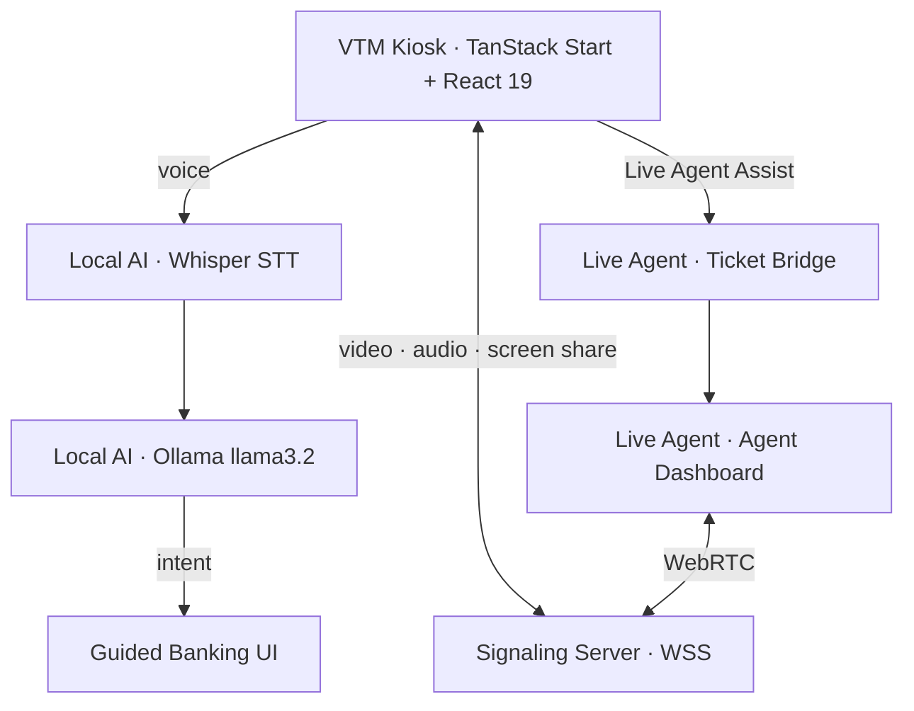

import VTMIntentDemo from "@/components/blog/VTMIntentDemo.astro";
import VTMHandoffDemo from "@/components/blog/VTMHandoffDemo.astro";

## The spark

During a brainstorming session for the OCBC Ignite Innovation Challenge 2025, our lecturer, who was mentoring us, said something that stuck with me: before ATMs, there were human tellers. None of us had thought about it. We had grown up with machines as the default. It changed how I saw the problem. What if a banking kiosk let customers speak as they would to a teller, at any time of day? I pictured a Virtual Teller Machine where a local AI handled routine requests and a human agent could step in when needed.

I knew React and had worked with local AI, but I had never used WebRTC. Learning it in one weekend was ambitious, but we needed it for live video, audio, and screen sharing.

## The build

The OCBC VTM is a smart banking kiosk. Customers speak their request. Whisper transcribes it in the browser, then a local LLM classifies the intent. The interface either opens a guided flow or routes the customer to a live agent. WebRTC handles the video, audio, screen sharing, and annotations for that conversation.

I chose local AI so voice data stayed on the kiosk and the core flow worked offline. I kept the project in a monorepo so I could start the full stack with one command for the judges.

### System architecture

The kiosk connects the local speech and language models to the guided banking interface. A ticket bridge and signalling server connect it to the agent dashboard when the customer asks for help.

The user does not need to see those services. The interface only needs to turn an open-ended sentence into one clear next step. Try the requests below to see how the local pipeline routes each one.

<VTMIntentDemo />

## Designing the handoff

I did not want the AI to bluff its way through every request. A routine remittance could stay in a guided flow, while a loan or card replacement went to a human. The kiosk created a ticket with the customer's context, then connected both sides through WebRTC. The agent could talk to the customer, view their shared screen, and annotate the interface.

The example below follows a loan enquiry. Request an agent to see the kiosk pass the amount and tenure to the agent dashboard.

<VTMHandoffDemo />

## Getting WebRTC through HTTPS

The biggest technical challenge was the security setup around WebRTC. Everything worked on localhost over HTTP. Once we switched to HTTPS for camera access, connections would initialise but never complete. My teammate and I spent the night tracing the failure across each service.

I had not realised that local development still needed HTTPS for the kiosk and agent dashboard, WSS for the signalling server and ticket bridge, and trusted TLS certificates across the stack. mkcert gave us the certificates, but wiring each service correctly took until 4 am. When the agent video finally appeared, the relief was immediate.

## The result

We did not win the hackathon, but a teammate and I received internship offers. I now work on OCBC's mobile banking app.
